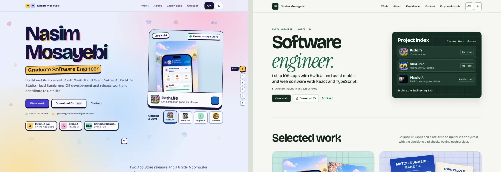
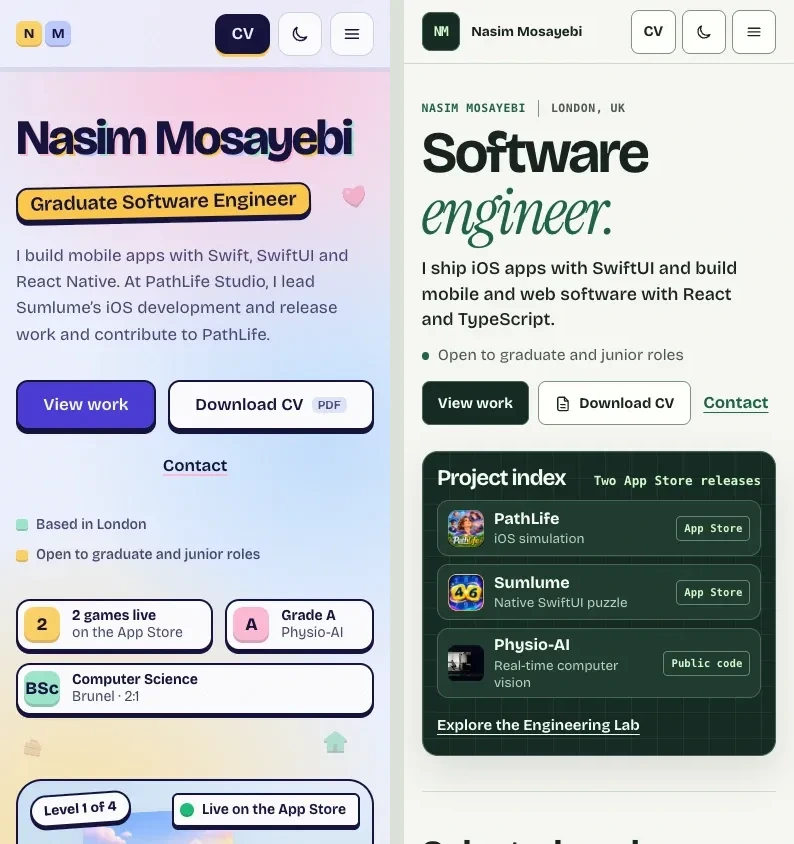

# Portfolio V4 design and engineering report

**Nasim Mosayebi · 23 November 2026**

**Audience:** UK graduate and junior software engineering recruiters and hiring managers

## Baseline and audit

GitHub confirmed that Phase 2 PR #2 merged into `main` at `0c0afe6`. Its head was the reviewed `fab8277`, and the Pages run for the merge succeeded. V4 branches from that deployed merge commit. The untracked recruitment-readiness audit was read and kept outside the branch. The Phase 2 report, puzzle engine and rule tests were compared with the merge commit. The professional CV PDF and Word source are byte-identical to that baseline. [Phase 2 PR](https://github.com/Nasim1801/portfolio/pull/2) · [Deployed baseline](https://github.com/Nasim1801/portfolio/actions/runs/45149606808) · [Phase 2 evidence report](PORTFOLIO_PHASE_2_ENGINEERING_CREDIBILITY_REPORT.md)

The live pages responded across all nine routes. I reviewed their rendered desktop and mobile views alongside the prior recruitment audit, React components, media manifest, build scripts and deployment workflow.

- The name and job target were clear, and the shipped-app proof was genuine. Sticker badges, the rotating level selector, background canvas objects and a numbered scroll rail gave game promotion too much visual weight. A recruiter scanning for programming work outside games had to interpret that framing first.
- On the 390 px homepage, Selected work began around y=1,248. The Physio-AI case was less discoverable from the first screen. Mobile retained the desktop hero’s layers and then stacked them.
- The shared case-study layout had large gaps on desktop and put the at-a-glance facts before imagery on mobile. Real screen captures were an asset. Landscape evidence was difficult to read at phone width without opening the original.
- Bricolage Grotesque was recognisable and worth retaining. Layered display text and dense labels reduced legibility in the hierarchy. The motion system also created several distinct sources of visual change.
- Phase 2 verified layout and evidence links and added meaningful testing boundaries. Its generated page files supplied route metadata, while most actual project content still depended on React mounting in the browser.

## Direction and implementation

| Direction considered    | Strength                                                                                                                        | Cost                                                                                         |
| ----------------------- | ------------------------------------------------------------------------------------------------------------------------------- | -------------------------------------------------------------------------------------------- |
| Product launch pages    | Large, expressive App Store imagery and a familiar product story                                                                | Would reinforce mobile-game promotion and give team and research work inconsistent treatment |
| Minimal résumé          | Fast scanning and familiar recruitment structure                                                                                | Would underuse authentic imagery and make the portfolio harder to remember                   |
| Editorial project index | Names, roles and inspectable evidence share a clear hierarchy. Product art can retain its own colour within a consistent system | Needs deliberate image selection and typography to give a compact page enough character      |

I chose the editorial project index. The muted paper and ink theme, mint highlights and ruled green project panel give the site a signature. Bricolage Grotesque carries body, labels and titles. Self-hosted Instrument Serif italic adds an editorial accent to the role heading. Light and dark themes share spacing, interactive states and contrast-aware tokens. The grid shifts from a two-column opening to a compact single-column reading order, with restrained hover effects and reduced-motion support.

The homepage now puts location, role, SwiftUI and React/TypeScript, graduate and junior availability, two App Store releases, the CV and contact within the opening scan. PathLife, Sumlume and Physio-AI share the project index. Shipping evidence and public source are labelled. PathLife and Sumlume have product-led covers. Physio-AI’s wider card preserves its landscape dashboard. The portfolio and CO2 Tracker are easy to find in the next group. PawLife is visibly in development. The skills index retains project proof links and a selectable highlight.

Case studies pair a compact introduction and evidence actions with the gallery. On narrow screens, the first image follows the introduction and precedes the detailed facts. Shared section links, ordered architecture steps, source links and related-project navigation help reviewers reach the sections they need. Gallery arrows and thumbnails work with keyboard and touch. A native dialog provides focus return, Escape and arrow-key controls, plus zoom and pan for landscape captures and a link to open the original.

### Before and after

The light screenshots use Chrome with reduced motion at 1440 × 1000 and 390 × 844 CSS pixels. The before set came from the live Phase 2 site. The after set came from a local production build. All 36 route screenshots are in [the comparison directory](review/portfolio-v4/). The route logs record headings, dimensions and response status. [Before route log](review/portfolio-v4/before-routes.json) · [After route log](review/portfolio-v4/after-routes.json)





| Route                       | Desktop                                                                                                                                               | Mobile                                                                                                                                              |
| --------------------------- | ----------------------------------------------------------------------------------------------------------------------------------------------------- | --------------------------------------------------------------------------------------------------------------------------------------------------- |
| Home                        | [Before](review/portfolio-v4/before-home-1440.webp) · [After](review/portfolio-v4/after-home-1440.webp)                                               | [Before](review/portfolio-v4/before-home-390.webp) · [After](review/portfolio-v4/after-home-390.webp)                                               |
| Full homepage               | [Before](review/portfolio-v4/before-home-full-1440.webp) · [After](review/portfolio-v4/after-home-full-1440.webp)                                     | [Before](review/portfolio-v4/before-home-full-390.webp) · [After](review/portfolio-v4/after-home-full-390.webp)                                     |
| PathLife                    | [Before](review/portfolio-v4/before-pathlife-1440.webp) · [After](review/portfolio-v4/after-pathlife-1440.webp)                                       | [Before](review/portfolio-v4/before-pathlife-390.webp) · [After](review/portfolio-v4/after-pathlife-390.webp)                                       |
| Sumlume                     | [Before](review/portfolio-v4/before-sumlume-1440.webp) · [After](review/portfolio-v4/after-sumlume-1440.webp)                                         | [Before](review/portfolio-v4/before-sumlume-390.webp) · [After](review/portfolio-v4/after-sumlume-390.webp)                                         |
| Physio-AI                   | [Before](review/portfolio-v4/before-physio-ai-1440.webp) · [After](review/portfolio-v4/after-physio-ai-1440.webp)                                     | [Before](review/portfolio-v4/before-physio-ai-390.webp) · [After](review/portfolio-v4/after-physio-ai-390.webp)                                     |
| PawLife                     | [Before](review/portfolio-v4/before-pawlife-1440.webp) · [After](review/portfolio-v4/after-pawlife-1440.webp)                                         | [Before](review/portfolio-v4/before-pawlife-390.webp) · [After](review/portfolio-v4/after-pawlife-390.webp)                                         |
| This portfolio              | [Before](review/portfolio-v4/before-portfolio-1440.webp) · [After](review/portfolio-v4/after-portfolio-1440.webp)                                     | [Before](review/portfolio-v4/before-portfolio-390.webp) · [After](review/portfolio-v4/after-portfolio-390.webp)                                     |
| CO2 Tracker                 | [Before](review/portfolio-v4/before-co2-tracker-1440.webp) · [After](review/portfolio-v4/after-co2-tracker-1440.webp)                                 | [Before](review/portfolio-v4/before-co2-tracker-390.webp) · [After](review/portfolio-v4/after-co2-tracker-390.webp)                                 |
| Hospital Appointment System | [Before](review/portfolio-v4/before-hospital-appointment-system-1440.webp) · [After](review/portfolio-v4/after-hospital-appointment-system-1440.webp) | [Before](review/portfolio-v4/before-hospital-appointment-system-390.webp) · [After](review/portfolio-v4/after-hospital-appointment-system-390.webp) |
| Engineering Lab             | [Before](review/portfolio-v4/before-lab-1440.webp) · [After](review/portfolio-v4/after-lab-1440.webp)                                                 | [Before](review/portfolio-v4/before-lab-390.webp) · [After](review/portfolio-v4/after-lab-390.webp)                                                 |

At 390 px the homepage went from approximately 15,099 to 8,712 CSS px in height, and Selected work moved from y=1,248 to about y=791. The project index provides direct case links above that section. Dark-mode examples show the same hierarchy and controls. [Desktop homepage](review/portfolio-v4/after-home-1440-dark.webp) · [Mobile Physio-AI](review/portfolio-v4/after-physio-ai-390-dark.webp) · [Mobile Lab](review/portfolio-v4/after-lab-390-dark.webp)

### Media and project evidence

- **PathLife.** Verified the UK listing at iOS 2.1.3 under PathLife Studio Ltd and compared the current icon and dashboard artwork with the checked-in files. The case preserves the candidate’s game logic, SwiftUI, Android rebuild and support site contributions. The isolated Swift storage checks concern the team’s save-layer seam. Full app behaviour, restart, migration and authorship of the save module remain outside that check. [UK App Store](https://apps.apple.com/gb/app/pathlife/id6769602618)
- **Sumlume.** Verified the UK listing at iOS 2.0.0 under the same publisher and compared the icon and Classic board with the checked-in artwork. The case links the release and product page, then identifies the portfolio TypeScript playground, rule source and test suite. Native Swift behaviours and App Store purchase paths need separate verification. [UK App Store](https://apps.apple.com/gb/app/sumlume-number-match/id6799957684)
- **Physio-AI.** The case makes the public WebSocket server, retraining entry point and reproduction notes reachable from implementation evidence. The dissertation’s 96.23% is reported frame accuracy on one participant. In the local rerun, 3,390 of 7,153 test rows traced back to source rows also represented in training. The reconstruction of the confusion matrix and the synthetic ROC curves are illustrative. Evaluation on independent people and sessions remains unverified. [Phase 2 evaluation](PORTFOLIO_PHASE_2_ENGINEERING_CREDIBILITY_REPORT.md#physio-ai-evaluation)
- **CO2 Tracker.** The React prototype is public. Spring Boot and H2 outcomes in the case are from the team coursework service tested locally in Phase 2. The section names the candidate’s lookup and history integration work and identifies the photo flow as simulated. [Public React prototype](https://github.com/Nasim1801/co2-tracker)
- **PawLife.** Its source icon matches the local Expo configuration asset byte for byte. Native iOS captures dated 17–18 November remain the latest suitable local screenshots found. The current development status is stated on the card and in the case. [Asset provenance](ASSET-AUDIT-V4.md)
- **This portfolio.** Replaced the prior screenshot with an actual V4 capture. The case links the pre-render build, puzzle tests, Playwright checks and Pages workflow. Project case content and media provenance carry forward from Phase 2. [Portfolio source](https://github.com/Nasim1801/portfolio)

## Engineering review

- Native document navigation handles cross-route links, Back, fragments and direct visits. The former client click interception, animated background canvas, repeated autoplay and scroll-related effects were removed. The Lab preserves the puzzle and interactive Physio-AI walkthrough, with keyboard focus moved to an available tile after a match.
- Build-time React rendering produces nine pages and the GitHub Pages 404. Client entry points hydrate the shared route components and load only the current route chunk. Native links expose content, the CV and original screenshot files with JavaScript disabled. Lab fallback prose points to the corresponding case evidence.
- A shared static route list generates canonical URLs, descriptions, title, JSON-LD, Open Graph and Twitter tags, 1200 × 630 social images, and the sitemap. The social cards reuse authentic artwork and preserve the existing home card URL. The 404 has a no-index directive.
- Typed content and intrinsic media dimensions remain central. The cropped homepage artwork gets smaller WebP variants derived from the store originals. The case galleries retain their higher-resolution images. Offscreen images load lazily. Style and markup are colocated through CSS Modules. The build uses existing React DOM Server, Vite and Sharp dependencies.
- The release job requires lint, strict type checking, puzzle rules, the production build and browser QA. The deploy job depends on that passing build and is restricted to `main`. Pull requests execute the review gate.

### Performance

Lighthouse 12.8.2 ran with Chrome 157 headless on the local production previews for Phase 2 and V4. The mobile profile simulated a 412 × 823 screen, 150 ms RTT, 1,638 Kbps throughput and 4× CPU slowdown. The homepage row uses the median of three cold runs per build. The other values are single runs. All nine V4 routes were measured. [Run data and configuration](review/portfolio-v4/performance.json)

| Route                       | Performance before → V4 | LCP before → V4 | V4 accessibility / best practices / SEO |
| --------------------------- | ----------------------: | --------------: | --------------------------------------: |
| Home                        |                 92 → 94 | 3.23 s → 2.94 s |                         100 / 100 / 100 |
| PathLife                    |                 94 → 97 | 2.93 s → 2.56 s |                         100 / 100 / 100 |
| Physio-AI                   |                 97 → 98 | 2.56 s → 2.34 s |                         100 / 100 / 100 |
| Engineering Lab             |                 97 → 98 | 2.40 s → 2.13 s |                         100 / 100 / 100 |
| Sumlume                     |                   97 V4 |       2.57 s V4 |                         100 / 100 / 100 |
| PawLife                     |                   97 V4 |       2.42 s V4 |                         100 / 100 / 100 |
| This portfolio              |                   98 V4 |       2.26 s V4 |                         100 / 100 / 100 |
| CO2 Tracker                 |                   98 V4 |       2.19 s V4 |                         100 / 100 / 100 |
| Hospital Appointment System |                   98 V4 |       2.34 s V4 |                         100 / 100 / 100 |

All nine V4 runs recorded 0 CLS and 0 ms total blocking time. The mobile homepage transferred approximately 441 kB, down from 560 kB in Phase 2. Vite’s gzip estimate for initial homepage JavaScript fell from 101.78 to 88.63 kB, including V4’s two home dependencies. The shared CSS fell from 14.24 to 6.94 kB gzip. Narrower WebP posters gave browsers a smaller choice for the cropped artwork. An alternate paragraph font did not improve the simulated LCP in the trial, so the shipped type system retains the self-hosted body font. Homepage, PathLife and Sumlume simulated LCP remained above 2.5 seconds.

With the production preview running, the homepage run can be reproduced with:

```bash
npx --yes lighthouse@12.8.2 http://127.0.0.1:4173/portfolio/ \
  --only-categories=performance,accessibility,best-practices,seo \
  --output=json --output-path=lighthouse-home.json \
  --chrome-flags="--headless --no-first-run"
```

Lighthouse runs are lab estimates. Google’s good field thresholds are LCP ≤2.5 seconds, CLS ≤0.1 and INP ≤200 ms at the 75th percentile. TBT measures a lab main-thread blocking interval. V4 has no production field sample. [Google Web Vitals](https://web.dev/articles/vitals)

### Accessibility, tests and link verification

- Lint, strict TypeScript, the existing unit suite and the production build passed. Chromium verified **126 route, width and theme combinations** across all nine routes at 320, 360, 390, 768, 1024, 1440 and 1920 px.
- **36 axe scans** at 390 and 1440 px with the WCAG 2.2 target-size rule enabled and **172 internal route, fragment and file link checks** passed. The suite checked missing images, horizontal overflow, a single H1, masthead layout, mobile navigation, theme persistence, screenshots, modal zoom and keyboard focus. It also checked no-JavaScript content and metadata for all nine routes and the no-index 404. [Browser results](review/portfolio-v4/browser-checks.json)
- A separate keyboard walkthrough in the in-app browser verified skip focus, focus on the first menu link after opening, focus return after Escape, and changing the Physio-AI screenshot before closing the dialog. Manual visual review included the 320 px masthead, 390 px light and dark views and desktop cases. The Lab regression checks cover invalid and valid matches, keyboard navigation, focus recovery, clearing/resetting the board and the pose stages.

The test suite gives evidence about tested widths, browser states and keyboard paths. Full WCAG 2.2 AA conformance would require broader assistive-technology and user testing. [WCAG 2.2](https://www.w3.org/TR/WCAG22/)

GitHub sources, Apple listings, the studio and Sumlume product pages, and the YouTube demo URL responded to public link checks. LinkedIn returned HTTP 999 during anonymous verification, so profile rendering could not be confirmed through that check. The professional CV was served as PDF and downloaded from all three entry points with the same bytes as the baseline. The branch file inventory and diff were reviewed for credential and private-source material. The project galleries reuse public or authorised captures and the only new project screenshot is of this portfolio.

## Critical evaluations

### Visual design

The initial page had a clear name and distinct artwork but several competing compositional priorities. The V4 site is recognisable through the combination of its typography, index panel and ruled image stages. Colour and motion now support the reading order. The project media remains visually individual. Where source images are dense, the mobile gallery’s zoom makes detail reachable. The supporting work and skills section still take several screens on a small phone. They remain below the primary evidence.

### Engineering

The stronger evidence is the same-source pre-render/hydration design, the dependency-free frontend build changes, and verifiable navigation, accessibility and CI checks. Build-time image generation adds a reproducible step and a modest build cost. React hydration remains part of the interactive experience and consumes most of the initial JavaScript budget. Integration, performance and accessibility verification are bounded by the browsers and scenarios below. Existing native and research evidence retains its Phase 2 scope.

### Hiring

These are simulated screens of the portfolio and its disclosed evidence.

| Reviewer                                     | First 10 seconds                                                | First minute                                                                                | Deeper screen and rejection risk                                                                                                                                                                               |
| -------------------------------------------- | --------------------------------------------------------------- | ------------------------------------------------------------------------------------------- | -------------------------------------------------------------------------------------------------------------------------------------------------------------------------------------------------------------- |
| UK technical recruiter                       | Working location, availability, role, releases and CV are clear | Store links, plain-language project descriptions and the Brunel degree support shortlisting | Shortlist for graduate or mobile-leaning junior roles. Specialist backend roles would need stronger direct evidence.                                                                                           |
| Graduate software engineering hiring manager | Shipped apps sit alongside an individual systems project        | PathLife contribution and Physio-AI pipeline offer concrete interview topics                | Invite for a technical discussion. Probe the model evaluation split, state persistence and how tests were selected. The application could fall short where production team code ownership is a hard criterion. |
| Junior iOS hiring manager                    | SwiftUI and two App Store releases are immediate                | Sumlume ownership and PathLife’s separate iOS and Android roles are clear                   | Invite for an initial screen. Ask for an attributable Swift change and native regression evidence. Teams screening primarily through native code samples may pass.                                             |
| Junior frontend hiring manager               | React and TypeScript appear alongside mobile skills             | The case-study gallery, Engineering Lab and this portfolio offer a working sample           | Consider an interview based on typed components, progressive rendering and browser checks. Complex product UI, API integration and larger team frontend work remain less visible.                              |
| Junior full-stack hiring manager             | Mobile is the primary signal                                    | CO2 Tracker and Physio-AI supply API, storage and interaction examples                      | Consider a general graduate screen. The private team service and research dataset limit independent backend reproduction, which can disqualify a backend-heavy application.                                    |

| Review dimension          | Phase 2 baseline |  V4 | Reason for the change                                                                                         |
| ------------------------- | ---------------: | --: | ------------------------------------------------------------------------------------------------------------- |
| Visual design             |              7.0 | 8.7 | Original editorial hierarchy, balanced first view and deliberate mobile layout                                |
| Engineering               |              8.0 | 8.8 | Content in static HTML, simpler routing, broader regression checks and inspectable builds                     |
| Recruitment effectiveness |              8.0 | 8.7 | Role, releases and evidence are easier to find. Native authorship and backend reproducibility remain bounded. |

The scores reflect judgment against this brief. The best immediate fit is a UK graduate software engineering or junior iOS application, with the portfolio and Lab as supporting evidence for junior frontend roles. The strongest remaining hiring improvement is an attributable native code or test artefact that can be shared publicly.
